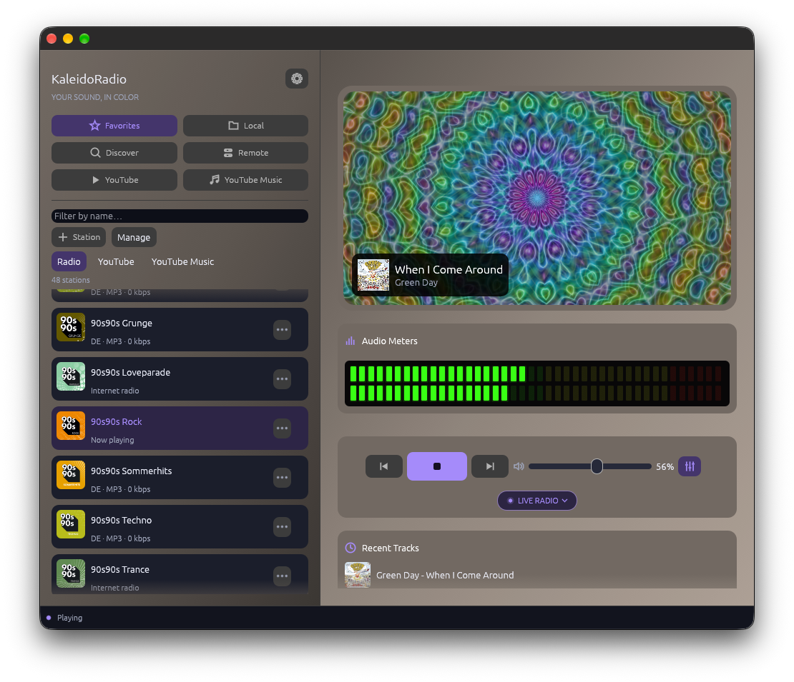

# KaleidoRadio

KaleidoRadio is a media player for macOS and Windows written in Rust. Discover internet radio, browse local and remote media, and play YouTube or YouTube Music with audio-reactive visuals.



## Features

- Search Radio Browser, save stations to Favorites, and move through Discover results with Previous and Next.
- Browse local folders and remote media over WebDAV, SMB, or SFTP.
- Browse YouTube videos and YouTube Music, choose video or audio playback, and download media to a chosen folder.
- Tune audio with a 10-band equalizer, built-in presets, auto volume, gapless playback, and crossfade.
- Switch between the built-in Kaleido visualizer and MilkDrop presets through projectM. Use the visualizer inline or in a separate window.

## Download and install

Choose a download from [KaleidoRadio v0.1.0](https://github.com/beatnik27/KaleidoRadio/releases/tag/v0.1.0).

| Platform | Download | Installation |
| --- | --- | --- |
| macOS (Apple silicon) | [DMG](https://github.com/beatnik27/KaleidoRadio/releases/download/v0.1.0/KaleidoRadio-0.1.0-macos-arm64.dmg) | Open the disk image and drag **KaleidoRadio.app** into **Applications**. |
| Windows (x64) | [Installer (.exe)](https://github.com/beatnik27/KaleidoRadio/releases/download/v0.1.0/KaleidoRadio-0.1.0-Windows-x64-Setup.exe) | Run the installer and follow the prompts. |
| Windows (x64) | [Portable build (.zip)](https://github.com/beatnik27/KaleidoRadio/releases/download/v0.1.0/KaleidoRadio-0.1.0-windows-x64.zip) | Extract the entire archive, then launch KaleidoRadio from the extracted folder. |

The macOS DMG includes FFmpeg, FFprobe, yt-dlp, Deno, projectM, and MilkDrop presets. The bundled MilkDrop engine requires macOS 26 or later. The app is ad hoc signed and has no Apple notarization, so macOS may block it on first launch.

## Build and run on macOS

Install a current stable [Rust toolchain](https://rustup.rs/), the Xcode Command Line Tools, and FFmpeg. Install yt-dlp and Deno if you plan to use YouTube features. With Homebrew:

```sh
xcode-select --install
brew install ffmpeg
brew install yt-dlp deno
```

From the project directory, run:

```sh
cargo run --locked
```

To build a macOS app bundle, run:

```sh
./scripts/build-macos.sh
```

The script creates `build/RustKaleidoRadio.app`. Pass `--run` to open the bundle after building.

### MilkDrop setup

The built-in Kaleido visualizer works without projectM. For MilkDrop, place a compatible `libprojectM-4.dylib` for your Mac's architecture in the project directory. The macOS build script copies it and the included `presets/` directory into the app bundle. Right-click the visualizer to choose **Kaleido Visualizer** or **MilkDrop Visualizer**.

## Keyboard shortcuts

| Shortcut | Action |
| --- | --- |
| Space | Start or stop playback, or pause or resume video |
| ⌘← / ⌘→ | Previous or next item in the queue |
| ⌘L | Toggle the library in compact view |
| ⌘1 / ⌘2 | Open Favorites or Discover |
| ⌘O | Add a local folder |
| Esc | Exit fullscreen or restore the window |

## Tests

Run `cargo test --locked`. Tests that require live services or additional tools are ignored by default.

## License

This project is licensed under the [GNU General Public License v3.0](LICENSE). The vendored glutin code includes its own [license](vendor/glutin/LICENSE).
